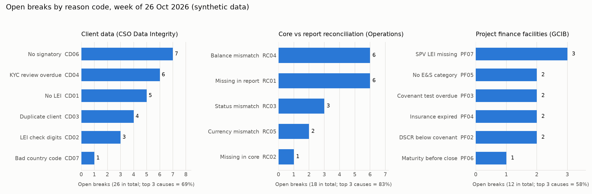

# IntegrityGate

A small control layer for operational data. It runs named rules over a dataset and writes an exception register in which every break has a reason code, an owner and an age. Running it again a week later shows which breaks are new, which are still open and which were fixed.

The point is not detection. Most banks already detect errors. The point is that when every break carries a reason, the team can see which few causes create most of the work and fix those at source.

All data in this folder is synthetic. No real client, account or facility data is used.

## Business impact

| Question a team lead asks | Where IntegrityGate answers it |
|---|---|
| How clean is our data this week? | `Summary` sheet: records checked, clean rate |
| What is still open, and for how long? | `Exception register`: status NEW / OPEN / RESOLVED and age in days |
| Who owns each break? | `owner` column: the front office or deal team that owns the record |
| Which causes should we fix first? | `pareto.png`: open breaks by reason code |
| Did last week's fixes stick? | `resolved_since_last_run` in the summary |

## Three rule packs, one engine

| Pack | Data | Example rules |
|---|---|---|
| `client_data` | Client master: CIF, LEI, KYC review date, accounts, signatories | Missing LEI, LEI check digits fail (ISO 17442), duplicate client, overdue KYC review, closed CIF with a live account, no signatory |
| `reconciliation` | Core banking extract compared with a downstream report | Missing on either side, status, balance (tolerance EUR 1.00) or currency mismatch |
| `project_finance` | Project finance facility register | Drawn above commitment, DSCR below covenant, overdue covenant test, expired insurance, no E&S category, SPV LEI missing |

Rules are plain data in `integritygate/rules.py`, so a reviewer can read what is checked without reading the engine. The thresholds are illustrative; in a bank they come from procedures and data owners.

## Results on the sample data (week of 26 Oct 2026)

| Pack | Records | Clean | Open breaks | Resolved since last week | Top 3 causes share |
|---|---|---|---|---|---|
| Client data | 500 | 94.8% | 26 | 27 | 69% |
| Reconciliation | 400 | 95.5% | 18 | 12 | 83% |
| Project finance | 60 | 80.0% | 12 | 1 | 58% |

Every open break is reason-coded (100%). Thirteen unit tests pass, including a check against GLEIF's own published LEI.



## Builds on

This extends the cargo intake pipeline in this repository. The same ideas carry over: a schema contract, row-level rejection reasons, a reconciliation check and deterministic reruns. What is new is a rule catalogue that can be swapped per domain, owner routing, and week-on-week ageing of breaks.

## Run it

```bash
pip install -r requirements.txt
python run_demo.py                                # writes data/ and outputs/
python -m unittest discover -s tests -t . -v      # 13 tests
```

## Limitations

- Synthetic data with seeded errors. The counts show the method, not any bank's real error rates.
- Thresholds and rule choices are examples, not a bank's procedures.
- The register is a file, not a workflow tool. In practice it would feed the team's existing tracker or a Power Query report.

## What I would do with real data

Run it unchanged for two weeks to get an honest baseline, agree the reason codes with the data owners, then pick the top cause and fix it at the point of entry. Success is the repeat rate of that cause falling, not the number of breaks found.
